  

Based in Manchester, I work primarily on agentic systems for companies across the UK and Europe. I enjoy designing solutions to complex problems across diverse data sources and environments. My work spans building and designing AI systems, including developing end-to-end frameworks for their evaluation.

AI is changing how we work, learn and understand the world: I build AI for good, with a particular focus in environment, education and science.

Let's build together!

---

### Things I've built

| Project | What it does | Stack |
|---|---|---|
| **[sentinel2-dl-deforestation](https://github.com/esteban-russi/sentinel2-dl-deforestation)** | Detects and maps deforestation in Colombia from satellite imagery, using a U-Net segmentation model trained on Sentinel-2 images and Dynamic World land-cover labels pulled from Google Earth Engine. | TensorFlow/Keras · Earth Engine · U-Net |
| **[uk-air-quality-control-dashboard](https://github.com/esteban-russi/uk-air-quality-control-dashboard)** | Monitors air pollution across major UK cities in real time and lets you ask questions about it in plain English, with an AI agent that analyses the last 48 hours of OpenAQ sensor data. | LangGraph · Gemini · Pydantic · Streamlit |
| **[customer-churn-personalisation-with-llms](https://github.com/esteban-russi/customer-churn-personalisation-with-llms)** | Predicts which customers are likely to leave, explains why with SHAP, and uses a large language model to write personalised emails that try to keep them. | TensorFlow · SHAP · Gemini |
| **[fibra](https://github.com/esteban-russi/fibra)** | An English/Spanish website that tells the stories of Colombian textile artisans and connects visitors with them directly. Designed as a storytelling platform rather than an online shop. | React 19 · Vite · Tailwind 4 · Framer Motion |
| **[parliamo-italiano](https://github.com/esteban-russi/parliamo-italiano)** | Practise conversational Italian by chatting or video-calling five AI tutors, each with their own city, personality and level (A1 to C1). They reply in natural Italian with an English translation and grammar notes, and speak back with lifelike voices. | React 19 · Express · Gemini (chat + TTS) · Web Speech API |
| **[BoVW-vs-CNN-Object-Recognition](https://github.com/esteban-russi/BoVW-vs-CNN-Object-Recognition)** | Compares Convolutional Neural Networks with a classic Bag-of-Visual-Words approach built on SIFT features for image recognition, tested on the Caltech256 and portraits datasets. | SIFT · PyTorch |

<b>Back to basics: algorithms I rebuilt from scratch</b>

Before reaching for a library, I like to build the thing myself once. These notebooks are where I took the classics apart to see how they work.

- [Probabilistic classification with Gaussian mixtures](https://github.com/esteban-russi/Probabilistic_Classiffication_with_GMM)
- [PCA from scratch on Iris](https://github.com/esteban-russi/PCA-from-Scratch-Using-Iris-Dataset)
- [LeNet-5 CNN on MNIST (PyTorch)](https://github.com/esteban-russi/MNIST-Convolutional_Neural_Networks_CNN)
- [Visualising classifier decision boundaries](https://github.com/esteban-russi/ML_Classification_Visualising_Decision_Boundaries)
- [Topic modelling COVID-19 tweets with LDA](https://github.com/esteban-russi/Topic_Modeling_LDA_with_COVID19_Tweets)

---

### My Stack:

**ML & data** &nbsp;

**Cloud** &nbsp;

**LLMs & Agents** &nbsp;

**Geo & Earth observation** &nbsp;

**Apps** &nbsp;

---

Interested in ML for climate and the environment, applied LLM agents, and tools that respect the people who use them. Always happy to solve problems, build, or chat, so reach out! 

